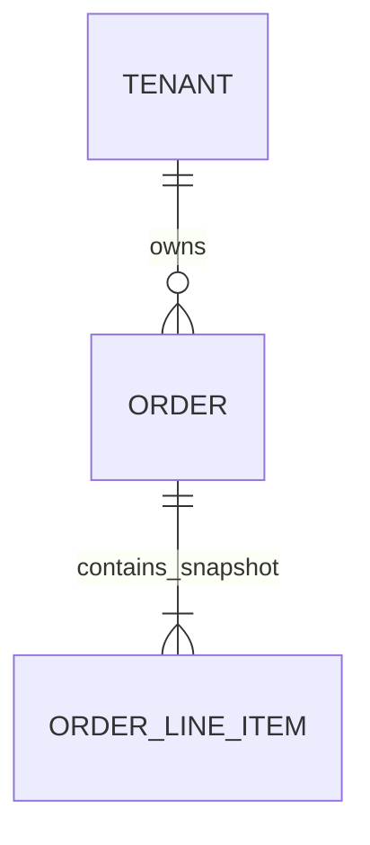

# Architecture doc template

Written by `architect` from the PRD. Consumed by `planner` and `implementer`.

```markdown
# Architecture: <name>

## Overview
What shape the system has and why, in a paragraph. Then the diagram.


## Constraints that drove the design
The constraints that actually forced choices - team size, existing stack,
latency budget, cost ceiling. If a constraint did not change a decision, cut it.

## Solution Options & CTO Trade-off Matrix
Compare 2-3 architectural alternatives before choosing:
| Option | Complexity | Scalability / Performance | Operational Cost (TCO) | Verdict |
|---|---|---|---|---|
| Option A: Pragmatic In-Process | Lowest | Up to 100 QPS | $0 extra | Simple, fastest delivery |
| Option B: Decoupled Async / Queued | Moderate | High (scalable workers) | Minimal (Redis/DB) | **RECOMMENDED** |
| Option C: Microservices / Distributed | High | Extreme | High ops tax | Rejected (Overkill) |

Rationale for the chosen option: ...

## Performance, Concurrency & Data Access Strategy
- **Sync vs Async boundaries**: Which flows run in HTTP request vs background queue.
- **Database Indexing & Query Plan**: Explicit indexes, N+1 query prevention.
- **Concurrency Control & Idempotency**: Optimistic locking, idempotency keys on mutations.
- **Caching**: Specific keys, TTL, and mutation invalidation triggers.

## Components
| Component | Responsible for | NOT responsible for |
|---|---|---|

The second column matters more than the first. It is what prevents drift.

## Dependency rule
Which layer may import which, as a table - or a recorded "no layering, and why".
This is the row every later change is checked against, so it is not optional.

| Layer | May import | Must never import |
|---|---|---|

## Data model
Domain-driven data strategy, workload-to-storage-engine selection, aggregate boundaries, nature of business truth, strict column types, and access-pattern indexing (`database-architecture`).

### 1. Domain Data Strategy & Workload-Driven Storage Engine Choice
- **Storage Engine Selection**: Justify why the chosen engine(s) fit the workload shape (e.g., PostgreSQL/MySQL for transactional OLTP, SQLite `WAL` for local-first/CLI/embedded, ClickHouse/DuckDB for analytical OLAP, built-in `tsvector`/`pgvector` vs dedicated search).
- **Aggregate Boundaries**: Which entities mutate together in a single ACID transaction vs. which cross-aggregate side effects synchronize asynchronously via **Transactional Outbox**.
- **Nature of Business Truth**:
  - *Mutable Current State*: Tables updated in-place with optimistic concurrency (`version`).
  - *Point-in-Time Historical Snapshots*: Transaction attributes frozen at creation time (`unit_price_cents_at_purchase`, `tax_rate_bps_snapshot`, `shipping_address_snapshot`) so future master-data edits never corrupt history.
  - *Immutable Append-Only Ledgers / Audit Facts*: Financial postings, inventory movements, and state transitions stored as `INSERT`-only records.

### 2. Entity-Relationship & Aggregate Diagram (`erDiagram` or `./diagrams/data-model.excalidraw`)


### 3. Schema & Table Contract (Domain Invariants, 3NF Write Model & Read Projections)
| Table / Aggregate | Truth Type (`State` / `Snapshot` / `Immutable Ledger`) | PK & Public ID Strategy | Columns & Strict Types (`TIMESTAMPTZ`, minor-unit `BIGINT`) | FK & `ON DELETE` Policy | DB Constraints (`CHECK` / Partial `UNIQUE` / `EXCLUDE`) | SSOT & Sync Contract (if denormalised) | Tenancy / RLS |
|---|---|---|---|---|---|---|---|
| `orders` | `State` + `Snapshot` items | `UUIDv7` internal, `ord_...` public | `subtotal_cents BIGINT`, `created_at TIMESTAMPTZ` | `tenant_id -> tenants(id) RESTRICT` | `CHECK (subtotal_cents >= 0)`, `UNIQUE (tenant_id, idempotency_key)` | Canonical SSOT | `ENABLE + FORCE RLS` on `tenant_id` |

### 4. Access-Pattern & Composite Index Matrix (ORM Projections & The ESR Rule: Equality -> Sort -> Range)
| Query / Access Pattern | Read/Write Path & N+1 Prevention (`selectinload` / `IN` / flat DTO) | Equality Columns (E) | Sort Columns (S) | Range Columns (R) | Index DDL & Type (B-Tree / `INCLUDE` / Partial `WHERE` / `GIN` / `HNSW`) | Pagination Strategy |
|---|---|---|---|---|---|---|
| List tenant orders by status | Flat DTO projection (`SELECT` explicit cols) | `tenant_id, status` | `created_at DESC, id DESC` | `subtotal_cents >= $3` | `CREATE INDEX CONCURRENTLY ... ON orders (tenant_id, status, created_at DESC, id DESC, subtotal_cents) INCLUDE (customer_id) WHERE deleted_at IS NULL` | Keyset cursor `(created_at, id) < ($1, $2)` |

### 5. Concurrency, Reservation Leases & Transactional Outbox Strategy
- **Row contention & locking**: Optimistic locking (`version`), atomic conditional updates (`balance_cents >= $1`), time-bounded **Reservation Leases** (`expires_at` for inventory/seat holds), or `FOR UPDATE SKIP LOCKED`.
- **Dual-write elimination**: Transactional Outbox (`outbox_events` written in the same ACID transaction) for webhooks, queues, search sync, and external side effects.

### 6. Data Lifecycle, Temporal/Audit History, Privacy (PII) & Zero-Downtime Evolution Policy
- **Soft-delete vs Audit history**: Partial unique indexes (`WHERE deleted_at IS NULL`) or append-only `_history` tables.
- **PII isolation & High-growth partitioning**: Separate PII tables for GDPR right-to-erasure, declarative `PARTITION BY RANGE (created_at)` for tables > 50M rows, and Expand-and-Contract migration plan.

## Key flows
For each significant flow: trigger, steps, what crosses a process or trust
boundary, and what happens on failure at each step.

## Decisions
Link to ADRs. Do not inline the reasoning here; it goes stale in two places.

- [ADR-0001](./adr/0001-....md) - ...

## Failure modes
| Where it fails | Who notices | What the system does | What the user sees |
|---|---|---|---|

## Security
Not a paragraph saying security was considered. Four things, each concrete:

- **Trust boundaries** - every place data crosses from one level of trust to
  another, and where validation and authorisation sit at each.
- **Identity** - how authn is established, how authz is decided, and what a
  stolen token buys until it expires.
- **Secrets** - where each one lives, who can read it, and how it rotates.
- **Data** - the classification table: field, personal or not, who reads it,
  retention, what a deletion request does.

Then the threats considered, each ending in mitigate / eliminate / transfer /
accept - an accepted risk names who accepted it. `security-discipline` →
`references/threat-modeling.md` is how to produce this in one sitting.

## Considered and rejected
Brief. Saves the next person from re-proposing a dead end.
```
